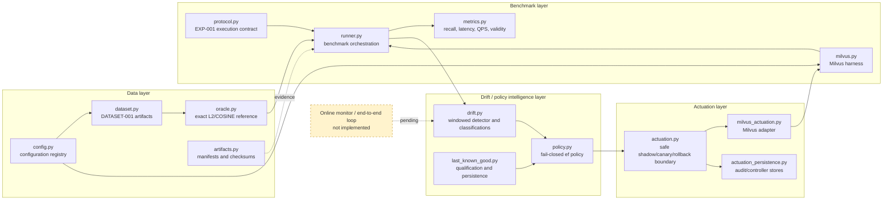
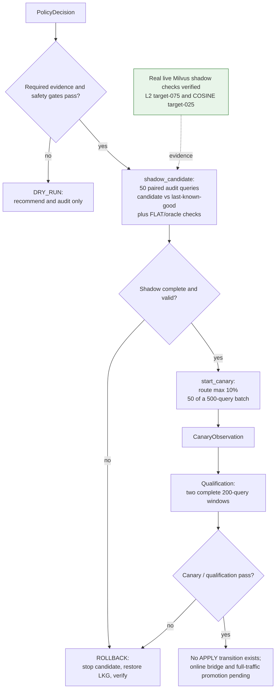

# Adaptive Vector DB Tuning System — Project Report

**Evidence basis:** committed repository state at `HEAD 59a7655`, including commits `7b2b239` (ADR-002 accepted) and `2182878` (roadmap status update). The worktree currently contains uncommitted edits to `ARCHITECTURE.md` and `ROADMAP.md` that revert those two status updates; those edits were preserved and are not used for the committed-state claims below. Live shadow evidence was re-run against the local Milvus stack during this review.

## 1. Project overview

Vector databases expose search parameters that trade result quality for latency, but a fixed setting can become unsuitable when a range/threshold-query workload changes. The project addresses this problem for L2 and COSINE range queries on one Milvus HNSW backend, with the safety requirement that a bad recommendation must fail closed and be reversible.

The current system combines a reproducible Milvus benchmark and exact FLAT/oracle reference, an offline drift detector and tuning policy, and a safety-gated actuation boundary with durable audit/controller state and a Milvus adapter. It can evaluate candidate settings through shadow and canary boundaries, but the online monitor/orchestrator and live automatic tuning loop are not yet wired end to end.

## 2. Architecture diagram



The implemented actuation action space is `NO_CHANGE`, `RECOMMEND_EF`, `START_CANARY`, and `ROLLBACK`; there is no implemented `APPLY` action to move a candidate to 100% traffic.

## 3. Safe-actuation workflow



The policy is pure and does not itself mutate Milvus. The adapter boundary implements shadow, canary routing, stop/restore, health checks, identity checks, and audit handling; live end-to-end canary, qualification, and rollback evidence remains pending.

## 4. What is built and verified

### EXP-001: verified Milvus smoke baseline

`EXP-001` is recorded as **VERIFIED — LIVE SMOKE ACCEPTANCE PASSED** in `EXPERIMENT_LOG.md`, with authoritative evidence under `artifacts/exp-001/run-20260801T161924Z/`.

The run used 10,000 base vectors, 50 calibration queries, 200 measured queries, 128 dimensions, L2 and COSINE metrics, FLAT and HNSW (`M=16`, `efConstruction=200`), `limit=100`, and `ef ∈ {100, 200, 400, 800, 1600}`. Aggregate HNSW results were:

| `ef` | Mean recall@threshold | Mean p95 latency |
|---:|---:|---:|
| 100 | `0.895965` | `3.1604 ms` |
| 200 | `0.970187` | `3.6582 ms` |
| 400 | `0.993641` | `4.0113 ms` |
| 800 | `0.998954` | `4.6551 ms` |
| 1600 | `0.999817` | `5.0889 ms` |

The run recorded zero failed measured queries, zero threshold violations, valid QPS comparisons for all 36 configurations, FLAT/oracle agreement for all 1,200 pre-timing checks, and no HNSW index-identity mismatch across 152 identity checks. The maximum p95-latency coefficient of variation was `26.023708345393032%`, below the reviewed `30%` ceiling. This verifies the smoke contract; it does not establish an optimal `ef`, workload-drift adaptation, production readiness, or backend superiority. The earlier EXP-003 run remains historically inconclusive: 16/36 configurations (`44.44%`) exceeded its former `20%` variance ceiling.

### ADR-002: detector and policy contract

ADR-002’s committed status is **Accepted**. Its acceptance note says the design was reviewed, implementation was committed through `9442ea4`, and `131/131` tests passed at that point. “Accepted” means the architecture/design contract is approved for the documented implementation direction. It does **not** mean the drift detector has production-calibrated evidence, that automatic policy actuation is authorized, or that the live online loop is complete. The ADR itself keeps the evidence status as `INFERRED` and states that integration into the live benchmark harness is separate and pending.

### Drift detector and policy: offline evidence

The stationary replay produced zero false positives in both metrics: `0/299` for L2 and `0/299` for COSINE, with point estimates `0.000000000000` and one-sided 95% Clopper–Pearson upper bounds `0.009969146793` for each. The drift-injection replay covered five synthetic scenarios across both metrics: `0/10` false negatives and `10/10` correct classifications. Abrupt scenarios were detected at delay `0`; gradual vector drift was detected at delay `2`. These are finite synthetic replay results, not evidence of generalization to an online production workload.

The current policy supports dry-run recommendations and canary decisions, with fail-closed health, identity, audit, quality, latency, and rollback gates. It has no automatic full-traffic apply action. The current local test suite also passes:

```text
Ran 138 tests in 1.331s
OK
```

### Actuation adapter: live shadow evidence and limits

Two real, non-actuating `shadow_candidate` calls were run against live Milvus collections. Each audited 50 queries and compared candidate and last-known-good behavior against the FLAT/oracle reference:

```text
{"audited_query_count": 50, "candidate_ef": 800, "candidate_flat_oracle_agreement": true, "detail": "FLAT/oracle exact baseline agreed; HNSW was evaluated as recall", "failed_query_count": 0, "last_known_good_ef": 400, "last_known_good_flat_oracle_agreement": true, "metric": "L2", "success": true, "threshold": "target-075", "threshold_violation_count": 0, "timeout_query_count": 0}
{"audited_query_count": 50, "candidate_ef": 400, "candidate_flat_oracle_agreement": true, "detail": "FLAT/oracle exact baseline agreed; HNSW was evaluated as recall", "failed_query_count": 0, "last_known_good_ef": 200, "last_known_good_flat_oracle_agreement": true, "metric": "COSINE", "success": true, "threshold": "target-025", "threshold_violation_count": 0, "timeout_query_count": 0}
```

These results verify the live shadow/read path for the two tested tuples. They are not a live online integration loop: no live canary qualification, automatic promotion, deliberate-failure rollback, or restart-persistence run has been completed.

## 5. What is not done yet

- Online workload monitoring and continuous drift-to-policy orchestration.
- Live end-to-end wiring of the adapter into the benchmark/online path.
- Live canary qualification, full-traffic apply, rollback, and restart-persistence evidence.
- Comparative baseline benchmarks against static configuration and periodic manual retuning.
- Dashboard or polished professor/demo workflow.

## 6. Novelty and research positioning

The related-work table in `RESEARCH_PLAN.md` identifies adjacent systems rather than a proven novelty claim. VDTuner (ICDE 2024) studies multi-objective vector-database parameter tuning for top-k recall/speed; Quake (OSDI 2025) focuses on adaptive multi-level partitioning; UNIFY (VLDB 2025) addresses range-filtered ANN; and Exqutor (arXiv 2025/2026) addresses one-shot adaptive planning for vector-augmented analytical workloads. The project’s proposed gap is the combination of pure distance-threshold range queries, continuous workload-drift response, and safety-gated actuation/rollback on one backend. `RESEARCH_PLAN.md` labels this gap as **INFERRED** and non-exhaustive, so it is a positioning hypothesis, not an established publication claim.

## 7. Honest current completion estimate

**INFERRED estimate: approximately 40–45% of the Core end-to-end deliverable.** The reproducible Milvus baseline is verified, the detector/policy and actuation boundary have substantial offline implementation and test coverage, and live paired shadow reads now have evidence. The main research deliverable is still missing: an online monitor/orchestrator, integrated live dry-run artifacts, live canary/rollback evidence, comparative baselines, and a demo. The roadmap therefore correctly keeps Phase 1 active and the safe-actuation and benchmark modules in progress rather than verified.

## 8. Immediate next steps

1. Register a dedicated dry-run integration experiment and wire `milvus_actuation.py` into the existing EXP-001 harness; keep the path non-actuating.
2. Produce raw evidence for deliberate query failure, health failure, identity mismatch, rollback, and process-restart persistence.
3. Implement the workload monitor and online orchestrator connecting query windows to `drift.py`, `policy.py`, and the actuation boundary.
4. Run static-configuration and periodic-manual-retune baselines under the same frozen workload contract.
5. Build a minimal evidence-focused dashboard/demo after the integration and baseline results are reviewable.
