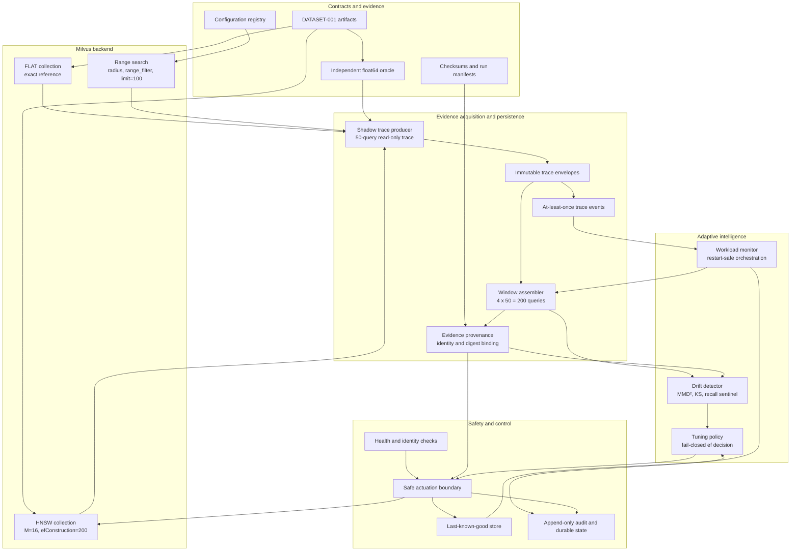
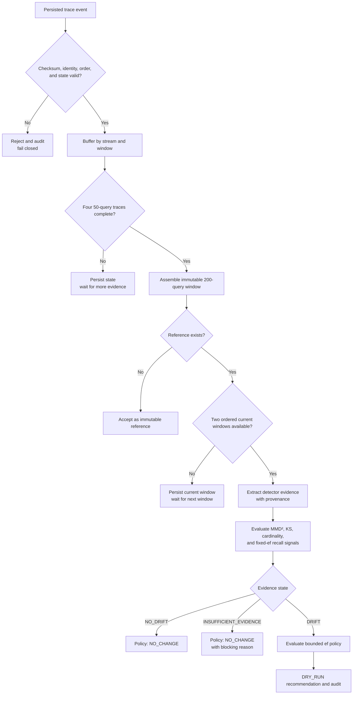
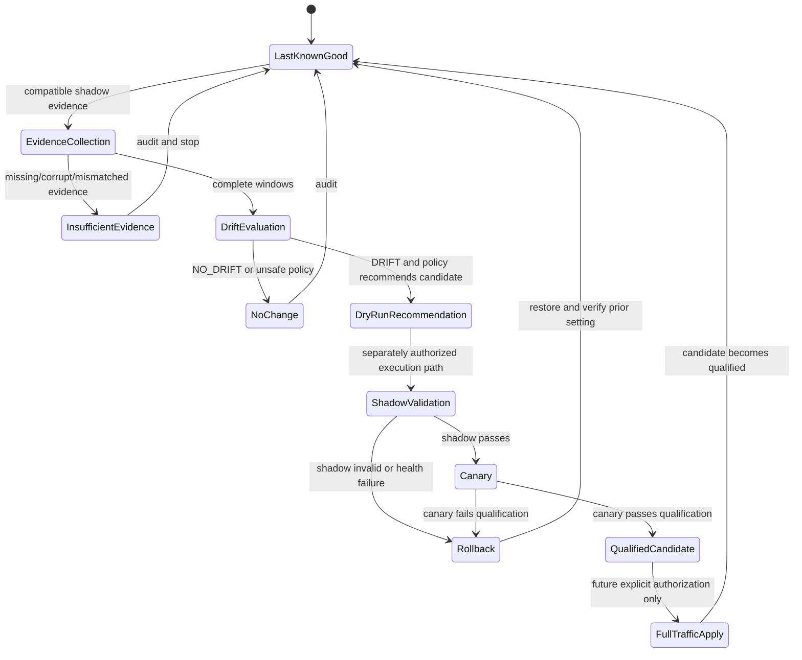
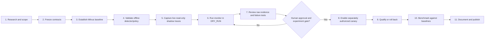

# Online Adaptive Workload-Aware Vector Database Tuning System

**Design document:** v0.1.0
**Status:** Proposed system design aligned with accepted ADR-001, ADR-002, and ADR-004; live automatic actuation is not authorized.
**Backend:** Milvus Standalone, pinned by ENV-001
**Primary scope:** L2 and COSINE distance-threshold/range queries under workload drift

## 1. What we are building

We are building a **backend tuning controller that runs beside Milvus**.

The controller observes vector range-query behavior, detects when the workload changes, evaluates whether the current HNSW search effort is still appropriate, and produces a safe tuning decision. It is not a replacement for Milvus, a browser extension, or a general-purpose vector database.

The project has two product surfaces:

1. **Core service/controller:** workload monitoring, drift detection, policy evaluation, safe actuation, rollback, and audit logging.
2. **Optional dashboard/demo UI:** displays latency, recall, drift state, recommendations, active configuration, and rollback history. The UI is not required for the research contribution.

The current research control variable is Milvus HNSW query-time `ef`. Index-build parameters such as `M` and `efConstruction` are fixed for the Core experiment and are not automatically changed.

## 2. Problem and objective

Vector search settings trade accuracy for resource cost:

- Lower `ef` usually reduces search work and latency but can reduce recall.
- Higher `ef` usually improves recall but increases search work and latency.
- A setting that is good for one workload can become unsuitable when query vectors, thresholds, result cardinalities, or observed quality change.

The objective is to determine whether a workload-aware controller can maintain an acceptable recall/latency balance under drift while preserving correctness and preventing unsafe configuration changes.

The project must measure, not assume, changes in:

- threshold-query recall;
- latency distribution and p95/p99 latency;
- QPS and throughput;
- result cardinality and cap effects;
- memory and resource usage;
- drift-detection accuracy and false-positive rate;
- time to qualify or roll back a candidate setting.

## 3. Scope boundary

### In scope

- One backend: Milvus.
- Pure vector distance-threshold/range queries.
- L2 and COSINE metric strata.
- FLAT exact reference and HNSW approximate track.
- Workload-window assembly from persisted shadow observations.
- Statistical drift detection using the accepted detector contract.
- HNSW `ef` policy decisions.
- DRY_RUN recommendations and append-only audit evidence.
- Safety gates, last-known-good state, shadow evaluation, canary evaluation, and rollback design.

### Out of scope for the Core milestone

- Building a new vector database.
- Replacing Milvus or implementing a new ANN index.
- Browser extensions.
- k-NN/ANN tuning as a separate research problem.
- Hybrid search, filtered search, and multi-tenant tuning.
- Multi-backend policy transfer.
- Automatic rebuilding of indexes or changing `M`, `efConstruction`, or `nlist`.
- Unreviewed automatic full-traffic promotion.

## 4. System context

The application sends normal queries to Milvus. The controller receives an asynchronous, bounded evidence stream rather than sitting on the foreground request path. Evidence is persisted before it is consumed by the monitor.

```mermaid
flowchart LR
    APP["Application or API"] -->|foreground range query| MILVUS["Milvus Standalone"]

    MILVUS -->|query and result telemetry| PRODUCER["Shadow trace producer"]
    PRODUCER -->|persist immutable 50-query envelope| TRACE["Trace artifact store"]
    PRODUCER -->|publish envelope reference| EVENTS["Trace event source"]

    EVENTS --> MONITOR["Workload monitor"]
    TRACE --> MONITOR
    MONITOR --> DETECTOR["Drift detector"]
    DETECTOR --> POLICY["Tuning policy"]
    POLICY --> SAFETY["Safe actuation boundary"]
    SAFETY -->|read-only evaluation / future gated action| MILVUS

    MONITOR --> AUDIT["Monitor and actuation audit store"]
    SAFETY --> AUDIT
    AUDIT --> DASH["Optional dashboard / CLI"]

    ORACLE["Independent exact oracle + FLAT reference"] --> PRODUCER
```



The controller does not need a paid external service. The research setup is self-hosted and uses local artifacts, Milvus, PyMilvus, and Docker. Cloud deployment is optional and would introduce infrastructure cost.

## 5. Logical architecture



## 6. Component responsibilities

| Component | Responsibility | Input | Output | Failure behavior |
|---|---|---|---|---|
| Configuration registry | Defines allowed metrics, thresholds, limits, index identity, and `ef` values | Frozen experiment/configuration | Validated configuration | Rejects undocumented, out-of-range, or mixed settings |
| Milvus adapter | Creates/loads FLAT and HNSW collections and executes range searches | Validated configuration and vectors | Search hits, identity snapshots, timings | Fails closed on connection, load, identity, or semantic mismatch |
| Exact oracle | Computes independent float64 L2/COSINE threshold results | Stored vectors and thresholds | Exact ordered hits and uncapped cardinality | Marks evidence invalid on numerical or semantic disagreement |
| Shadow trace producer | Performs bounded read-only candidate versus last-known-good observations | Query batch, candidate `ef`, last-known-good `ef` | Persisted 50-query trace envelope | Does not publish an unpersisted or incomplete trace |
| Trace artifact store | Persists immutable evidence with checksums | Trace envelope | Reloadable trace artifact | Rejects corruption, duplicate fields, bad hashes, and non-finite values |
| Workload monitor | Groups compatible traces and survives restart | Trace events plus persisted state | Window results, detector/policy outcomes, audit records | Rejects duplicates, gaps, identity changes, and incomplete windows |
| Window assembler | Builds one 200-query window from four 50-query traces | Compatible trace envelopes | Immutable assembled window and manifest hash | Never imputes missing queries or silently reorders evidence |
| Drift detector | Separates input drift from quality drift | Reference/current windows | `NO_DRIFT`, `DRIFT`, or `INSUFFICIENT_EVIDENCE` | Fails closed when evidence is incomplete or provenance mismatches |
| Tuning policy | Converts validated drift evidence into a bounded `ef` decision | Drift decision, estimates, safety context | `NO_CHANGE`, `RECOMMEND_EF`, or gated action | Returns `NO_CHANGE` when gates fail; never mutates Milvus itself |
| Safe actuation boundary | Applies health, identity, step-size, shadow, canary, and rollback controls | Policy decision and evidence | Audit record and controlled action | Stops, restores last-known-good, and records the reason |
| Last-known-good store | Holds the latest qualified safe configuration | Qualification result | Restart-durable safe state | Missing/corrupt state blocks action |
| Audit store | Makes every decision and failure reviewable | Monitor/actuation records | Append-only evidence | Duplicate IDs and malformed records are rejected |
| Dashboard/CLI | Presents state and evidence to a human | Audit and metric records | Monitoring view and manual controls | Must not bypass policy or safety gates |

## 7. Data and identity model

Every observation is tied to a stream key. Observations may only be compared when these fields match:

- metric: `L2` or `COSINE`;
- threshold stratum, such as `target-025`;
- configuration identity;
- dataset/data identity;
- FLAT binding identity;
- HNSW binding identity.

The stream key prevents the detector from treating a database change, metric mix-up, threshold change, or dataset replacement as ordinary workload drift.

Each persisted trace contains 50 query observations. Each observation includes the query identity, vector/threshold context, exact-oracle result, FLAT result, sentinel HNSW result, recall evidence, and stage outcomes. Four compatible traces make one 200-query window.

The monitor keeps:

```text
reference window
previous current window
pending trace groups
processed event IDs
blocked/rejection reasons
durable audit outbox
```

The reference window is immutable during normal operation. Rebaselining requires an explicit human-approved workflow.

## 8. End-to-end operating workflow

### 8.1 Startup and validation

1. Start the pinned Milvus environment and verify health.
2. Load DATASET-001 and verify all checksums.
3. Create/load the FLAT exact collection and HNSW approximate collection.
4. Verify metric, dimension, index type, `M`, `efConstruction`, data identity, and collection bindings.
5. Validate the threshold contract, boundary fixtures, `limit=100`, and `Strong` consistency.
6. Load or initialize restart-durable monitor, last-known-good, and audit state.
7. Refuse to process evidence if any identity or state check fails.

### 8.2 Normal observation path

1. A query arrives for a configured range-query stream.
2. The foreground query is served by Milvus.
3. A bounded shadow job evaluates the candidate and last-known-good settings on sampled traffic.
4. FLAT and the independent oracle provide correctness evidence for the sampled queries.
5. The producer writes the trace envelope and checksum to durable storage.
6. Only after persistence does it publish a trace event.
7. The monitor consumes the event, verifies the checksum, checks stream identity, deduplicates it, and saves state atomically.
8. Four valid traces are assembled into a 200-query window.

### 8.3 Drift evaluation path

The detector compares a fixed reference window with two ordered current windows. It evaluates separate metric strata and does not pool L2 with COSINE.



### 8.4 Detector outputs

The detector must distinguish:

- **`NO_DRIFT`:** evidence is complete and no configured signal crosses its effect-size and statistical gates.
- **`DRIFT` / `INPUT_DRIFT`:** query vectors, thresholds, or exact result cardinalities changed materially.
- **`DRIFT` / `QUALITY_DRIFT`:** recall at fixed sentinel search effort degraded materially.
- **`INSUFFICIENT_EVIDENCE`:** missing, incompatible, corrupt, or unbound evidence. This is not treated as no drift.

The detector does not directly change Milvus.

### 8.5 Policy outputs

The policy evaluates the drift decision against:

- current `ef`;
- allowed `ef` values and maximum step size;
- predicted latency/recall response estimates;
- minimum improvement threshold;
- confidence/statistical evidence requirements;
- pre-action health and identity checks;
- last-known-good qualification;
- prior experiment authorization;
- operating mode, currently `DRY_RUN`.

Possible outputs are:

```text
NO_CHANGE       evidence is insufficient, unsafe, or improvement is unproven
RECOMMEND_EF    a bounded candidate is recommended and audited
START_CANARY    candidate passed policy gates and may enter a separately
                authorized canary path
ROLLBACK        candidate failed qualification or health checks
```

The policy is pure: it returns a decision and does not call PyMilvus.

## 9. Safe actuation workflow

The actuation layer is intentionally stricter than the detector and policy. A candidate must not reach live traffic merely because a statistical test found drift.



### Required safety gates

All of the following are required for a live tuning action:

1. Valid and complete evidence provenance.
2. Explicit confidence/statistical threshold.
3. Predicted improvement above the minimum threshold.
4. Pre-action Milvus health check passed.
5. Configuration and collection identity match.
6. Hard-bounded `ef` step size and valid allowlist value.
7. Tested rollback for the specific action.
8. Existing experiment evidence supporting this action class.
9. Dry-run and audit record available.
10. Failure detection and post-action qualification.

If any gate fails, the system logs a recommendation or rejection and does not mutate live configuration.

### Current actuation status

The current repository supports the design of the safe boundary, durable state, audit records, and read-only shadow evidence. The live end-to-end detector-to-policy-to-actuation loop, live canary qualification, and automatic full-traffic promotion remain gated by the roadmap and experiment evidence. No automatic actuation is authorized by this document.

## 10. Expected working process

The project is expected to progress through these stages:



### Stage 1: Research and scope

Define the pure range-query problem, review related work, state the novelty claim conservatively, and freeze the one-backend Core scope.

### Stage 2: Contract freeze

Register metrics, threshold rules, index identities, `ef` allowlist, result cap, evidence schema, safety gates, rollback behavior, and experiment IDs before using performance results.

### Stage 3: Baseline benchmark

Run FLAT and HNSW under the frozen DATASET-001/ENV-001 contract. Record recall, latency, QPS, result cardinality, resource use, variance, and index identity. The baseline establishes the measured cost/quality curve for `ef`.

### Stage 4: Offline intelligence validation

Replay stationary windows to measure false positives. Inject controlled drift to measure detection and classification. Test policy boundaries, invalid configurations, missing evidence, and deliberate failures.

### Stage 5: Live read-only shadow capture

Capture real Milvus traces without modifying the database. Persist all artifacts, bind evidence to exact collection/data identities, and verify no mutation occurred.

### Stage 6: DRY_RUN monitor

Run the monitor continuously or in bounded cycles. It assembles windows, evaluates detector and policy decisions, and records every accepted/rejected/blocked path. The monitor must not import or invoke a live actuation executor.

### Stage 7: Verification review

Review raw test output and immutable artifacts. Run deliberate failures for database unavailability, corrupted traces, duplicate events, identity changes, restart recovery, incomplete windows, invalid policy inputs, and audit-store failure.

### Stage 8–9: Authorized canary and rollback

Only after explicit human approval and a supporting experiment may a candidate enter a bounded shadow/canary path. A failed health or quality check stops the candidate and restores the last-known-good setting.

### Stage 10–11: Benchmark and documentation

Compare adaptive, static, and periodic-manual-retune baselines. Report confidence intervals, failure cases, resource costs, rollback behavior, and threats to validity. Do not report unverified hypotheses as results.

## 11. Expected normal behavior

Example expected sequence:

```text
Current state: HNSW ef=400, last-known-good=400

1. Monitor receives four valid traces for window W0.
2. W0 becomes the immutable reference window.
3. Four valid traces for W1 arrive; W1 is stored as current-1.
4. Four valid traces for W2 arrive; W2 is stored as current-2.
5. Detector evaluates reference→W1 and reference→W2.
6. If no signal crosses its gate:
      result = NO_DRIFT
      policy = NO_CHANGE
      Milvus calls for tuning = 0
7. If quality drift is detected and evidence is valid:
      policy = RECOMMEND_EF, for example ef=800
      mode = DRY_RUN
      audit record is written
      live setting remains ef=400
8. After a separately authorized canary path exists:
      candidate is shadow-tested
      candidate is canaried within the hard traffic bound
      candidate is qualified or rolled back
```

## 12. Expected failure behavior

| Failure | Expected response | Live mutation allowed? |
|---|---|---:|
| Milvus unavailable | Health failure, audit, stop processing | No |
| Trace checksum mismatch | Reject envelope and block affected stream | No |
| Duplicate event | Idempotent rejection and audit | No |
| Missing trace in a window | Keep pending state; do not fabricate evidence | No |
| Metric/threshold/index identity change | Reject as incompatible stream | No |
| Corrupt monitor state | Fail closed until repair/rebaseline | No |
| Detector evidence incomplete | `INSUFFICIENT_EVIDENCE` and `NO_CHANGE` | No |
| Policy candidate outside allowlist | Reject candidate | No |
| Candidate health failure | Stop candidate and restore last-known-good | Only rollback |
| Canary recall/latency failure | Roll back and record evidence | Only rollback |
| Audit store unavailable | Do not proceed with action; preserve outbox if possible | No |
| Restart during processing | Recover state atomically and deduplicate events | No unverified action |

## 13. Dashboard requirements, if implemented

The dashboard is a monitoring and review surface, not the control-plane authority. It should expose:

- backend health and collection identity;
- current and last-known-good `ef`;
- current mode: `DRY_RUN`, `CANARY`, or authorized production mode;
- query volume and window completion;
- latency p50/p95/p99 and QPS;
- exact cardinality and capped-result counts;
- recall at threshold;
- detector state and signal evidence;
- recommendation reason and expected tradeoff;
- shadow/canary qualification state;
- rollback reason and timestamp;
- artifact, manifest, and audit IDs.

The dashboard must not provide a direct “set `ef`” action that bypasses the policy and safe-actuation boundary.

## 14. Definition of done for the Core system

The Core system is complete only when all of these are true:

- Milvus range-query semantics pass boundary and exact-reference tests.
- The benchmark baseline has raw, reproducible evidence.
- The detector has stationary false-positive and injected-drift evidence.
- The policy is bounded, fail-closed, and tested at decision boundaries.
- The monitor persists and recovers state correctly.
- Evidence provenance remains bound across detector, policy, and actuation records.
- Shadow, canary, rollback, health, and deliberate-failure paths are tested.
- No automatic action is enabled without the required experiment and human approval.
- Static, manual-retune, and adaptive baselines are benchmarked under the same contract.
- Documentation, architecture records, experiment logs, and technical debt are updated.

## 15. Manual walkthrough for the eventual demo

1. Start the pinned Milvus stack and open the project’s monitor/CLI entry point.
2. Confirm the UI/CLI reports Milvus health, dataset identity, metric, index identity, and `ef=400`.
3. Run the stationary workload and show `NO_DRIFT → NO_CHANGE`.
4. Inject a documented workload change in a separate experiment stream.
5. Wait for two complete current windows.
6. Show the detector classification and the recommended bounded `ef` change.
7. Confirm the system is still in `DRY_RUN` and Milvus was not mutated.
8. Open the audit record and show the evidence/provenance hashes.
9. In a separately authorized test environment, trigger a deliberate candidate failure.
10. Confirm the system records the failure and restores the last-known-good configuration.

This walkthrough is a future acceptance procedure. It is not evidence that the live end-to-end loop is currently verified.
